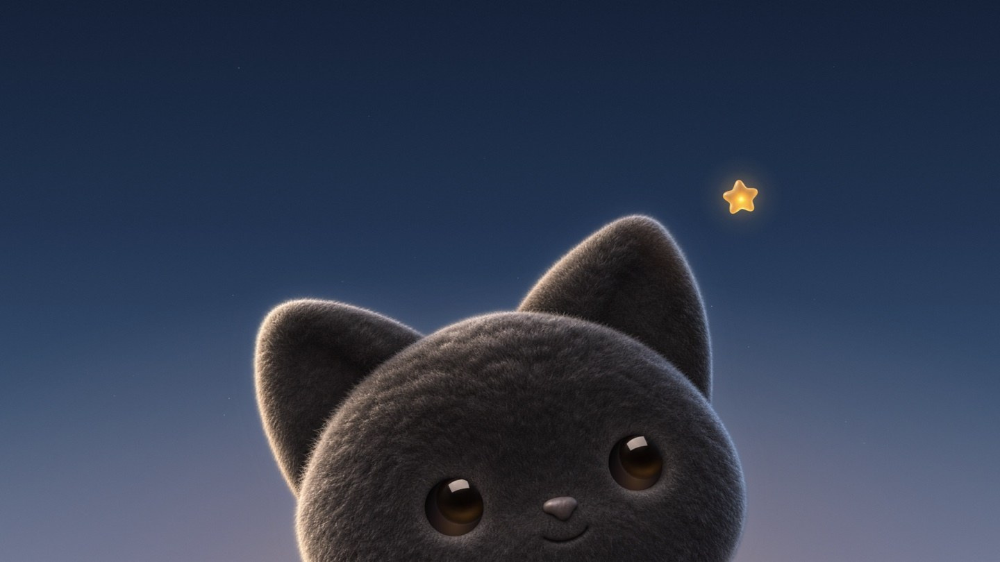

  

<h1 align="center">Hokucat</h1>

<strong>Live wallpapers for macOS, one for each display.</strong>

  English · <a href="README.zh-CN.md">简体中文</a> · <a href="docs/ai-wallpapers.md">Create a wallpaper</a> · <a href="https://github.com/ar-gen-tin/hokucat/releases">Releases</a>

Open Hokucat from the menu bar. In the Wallpaper Dashboard, preview a wallpaper, pick a display, and apply it. The built-in Hokucat wallpaper follows the pointer and lets you drag its star. Version 1.4.73 draws the cat, sky, and particle trail with macOS Core Animation.

## Getting started

Hokucat is in review. The current Mac build targets macOS 13 or later and includes Apple silicon and Intel. Public installers will appear on the [Releases page](https://github.com/ar-gen-tin/hokucat/releases) after distribution review.

## Make your own wallpaper

Create a silent video loop with your preferred tool, or give the example prompt to Codex or Claude Code and generate one locally. The sample script builds an importable package. In Hokucat, choose **Wallpaper Dashboard → Import…** and select the package folder. [AI wallpaper guide and runnable example](docs/ai-wallpapers.md)

## Credits

Hokucat builds on [Grok Bot Wallpaper](https://github.com/Bodila51/grokbot-wallpaper) by 0xCodila. The cat artwork and the sample wallpaper in this repository were made for Hokucat. [Project lineage and asset credits](docs/credits.md)
