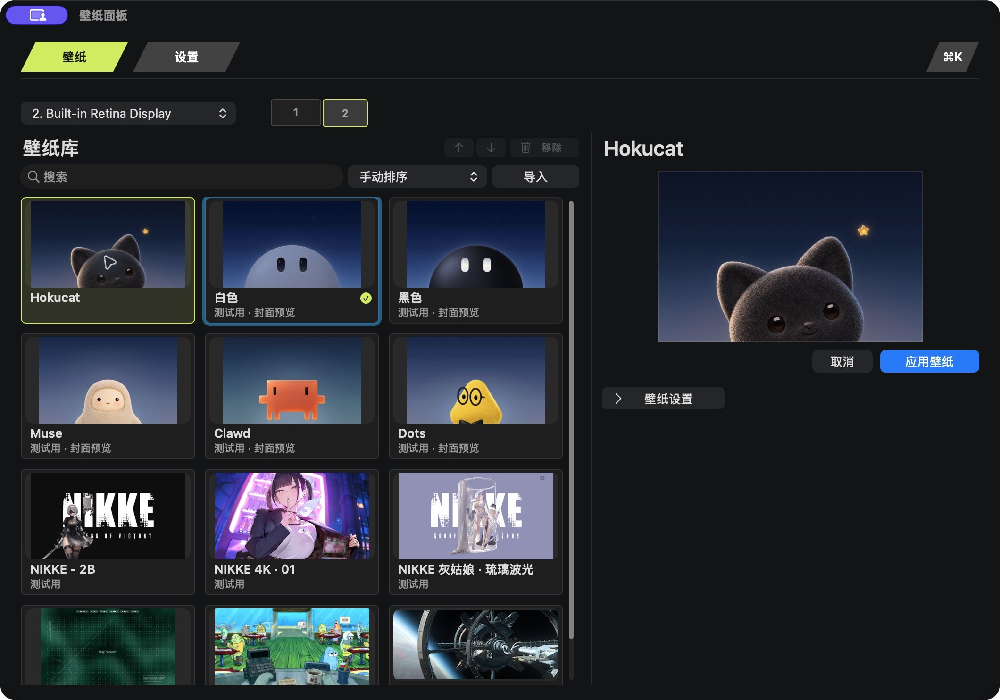

  

<h1 align="center">Hokucat</h1>

<strong>macOS 动态壁纸</strong>

  <a href="README.md">English</a> · 简体中文 · <a href="docs/i18n/README.zh-TW.md">繁體中文</a> · <a href="docs/i18n/README.ja.md">日本語</a> · <a href="docs/i18n/README.ko.md">한국어</a> · <a href="docs/i18n/README.pt-BR.md">Português (Brasil)</a> · <a href="docs/i18n/README.es.md">Español</a> · <a href="docs/i18n/README.fr.md">Français</a> · <a href="docs/i18n/README.ar.md">العربية</a>

在同一窗口浏览壁纸库、预览壁纸并调整可用设置。也可以用 AI 创作自己的壁纸。

[官网](https://hokucat.com/) · [观看演示视频](assets/hokucat-demo.mp4) · [创作壁纸](docs/ai-wallpapers.md#中文快速开始) · [常见问题](docs/faq.md#简体中文)

*视频为壁纸剪辑演示。预览材料中的第三方 PC 作品仅供测试使用，详见[作者署名与原作页面](docs/credits.md)。*

*壁纸面板截图来自 1.4.73 审阅版。*

## 快速体验

**当前预览构建为 1.4.74，安装包尚未开放公开下载。** 预览材料见本页，版本变化见[更新记录](CHANGELOG.md)。

当前 Mac 构建面向 **macOS 13 或更新版本**，包含 **Apple 芯片和 Intel** 版本。如果你已获得审阅版：

1. 从菜单栏打开 Hokucat，选择「壁纸面板」。
2. 选中一张壁纸，在同一页面预览，并调整该作品提供的设置。
3. 点击「应用壁纸」。如果连接了多块显示器，先选择要应用的屏幕。

## 把桌面设成你喜欢的样子

- **顺手浏览壁纸库。** 搜索作品，手动安排顺序，或按名称排序。
- **预览和设置放在一起。** 一边看效果，一边调整作品提供的选项。支持的视频可在应用前调整画面适配、播放速度和水平翻转。
- **整理更直接。** 拖动条目排序，右键调用常用操作；导入的壁纸可在确认后移出库，原始素材文件保留在原处。
- **熟悉的 Mac 交互。** 从菜单栏打开应用，沿用桌面操作习惯，也可以和追视鼠标、追逐星星的小黑猫互动。具体交互能力因壁纸而异。
- **多屏幕按需设置。** 如果你使用多块显示器，可以分别选壁纸，应用会记住各自的选择。

应用界面提供 **英语、简体中文、繁体中文、日语、韩语、巴西葡萄牙语、西班牙语、法语和阿拉伯语**，可在「设置」中切换。

## 用 AI 创作自己的壁纸

让 Codex、Claude Code 或 Grok Bot 帮你制作原创静音循环视频，也可以使用已有且获准使用的视频。[创作指南](docs/ai-wallpapers.md#中文快速开始)提供提示词和可运行示例，生成作品包后，在「壁纸面板 → 导入…」中选择整个文件夹即可。

作品包 v1 支持 **PNG/JPEG 静态图和静音 MP4/MOV/M4V 视频**。AI 参与创作，Hokucat 在本机播放导入后的素材。此格式暂不支持通用交互式 Web、Windows Scene 工程、实时鼠标或音频输入，以及实时 API 或 Agent 连接；部分内置或专门适配的壁纸有各自的互动能力。

[`examples/make-wallpaper.py`](examples/make-wallpaper.py) 用程序生成的动画是本仓库自写的独立示例，与用于测试展示的第三方 PC 壁纸分开署名。

## 问题、反馈与署名

兼容范围和导入方式见[常见问题](docs/faq.md#简体中文)。遇到问题时，可在 [Issues](https://github.com/ar-gen-tin/hokucat/issues) 附上 macOS 版本、Hokucat 版本和复现步骤。欢迎改进文档、翻译和公开示例，方式见[贡献说明](CONTRIBUTING.md)。

本仓库公开产品说明、演示材料和创作示例，**未包含完整的 Mac 应用源代码**。已记录的预览版变化见[更新记录](CHANGELOG.md)。

Hokucat 从 **0xCodila（Bodila51）** 的 [Grok Bot Wallpaper](https://github.com/Bodila51/grokbot-wallpaper) 发展而来。第三方作品归原作者，测试展示不代表已获准再分发。[项目谱系与素材署名](docs/credits.md)
