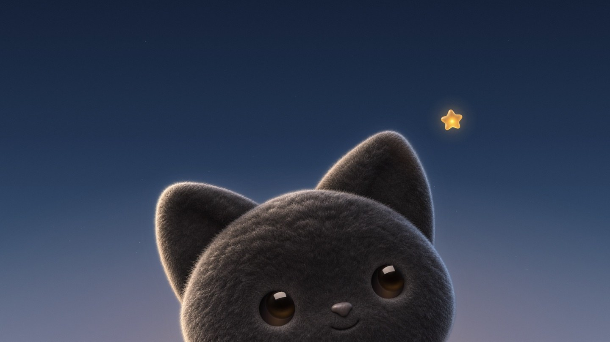

  

<h1 align="center">Hokucat</h1>

<strong>macOS 动态壁纸，每块屏幕都能单独设置。</strong>

  <a href="README.md">English</a> · 简体中文 · <a href="docs/ai-wallpapers.md#中文快速开始">创作壁纸</a> · <a href="https://github.com/ar-gen-tin/hokucat/releases">发布页</a>

从菜单栏打开 Hokucat，在壁纸面板预览作品、选择显示器，再点「应用壁纸」。内置小黑猫会追视鼠标，你也可以拖动它的星星。从 1.4.73 起，猫、星空和碎星由 macOS Core Animation 绘制。

## 安装

Hokucat 正在审阅阶段。当前构建支持 macOS 13 或更新版本，兼容 Apple 芯片和 Intel。公开安装包通过分发审核后会放在 [GitHub 发布页](https://github.com/ar-gen-tin/hokucat/releases)。

## 创作壁纸

用顺手的工具导出一段静音循环视频，或把示例提示词交给 Codex、Claude Code，让它们在本机生成。用示例脚本将视频整理成作品包，然后打开「壁纸面板 → 导入…」，选中作品包文件夹。 [AI 创作指南和可运行示例](docs/ai-wallpapers.md#中文快速开始)

## 署名

Hokucat 基于 0xCodila 的 [Grok Bot Wallpaper](https://github.com/Bodila51/grokbot-wallpaper) 开发。本仓库展示的小猫和创作示例由 Hokucat 制作。 [项目谱系与素材署名](docs/credits.md)
