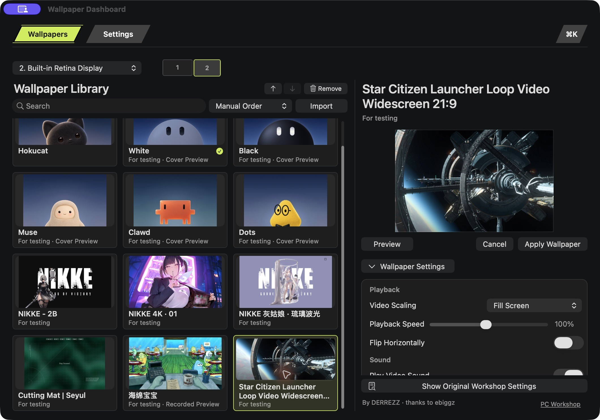

# Frequently asked questions

[English README](../README.md) · [简体中文](#简体中文)

## Can I download Hokucat now?

Yes. [Download Hokucat 1.4.87 Preview](https://github.com/ar-gen-tin/hokucat/releases/download/v1.4.87/Hokucat-1.4.87.dmg) built for **macOS 13 or later, on Apple silicon and Intel**. Intel hardware runtime has not been verified for this build. The release includes [SHA-256 checksums](https://github.com/ar-gen-tin/hokucat/releases/download/v1.4.87/SHA256SUMS.txt).

This preview has a **Developer ID signature and is not notarized by Apple**. Signing and notarization are separate checks. macOS may block the app when first opened; this is not a notarized stable release.

Open the DMG, drag **Hokucat** to **Applications**, then launch it from Applications. See the [changelog](../CHANGELOG.md) for the verified preview changes. The automatic GitHub source archives contain this documentation repository, not the Mac installer.

## Can AI help install it?

Yes. Copy the prompt in [Install with AI](install-with-ai.md) into Codex, Claude Code, or Grok Bot with access to your Mac. The assistant can check the download and signature, preserve your settings, and help install the app. Any first-launch security confirmation remains yours to approve. A browser-only chat without local computer access can provide guidance but cannot install it.

## How do I change a wallpaper?

Open **Wallpaper Dashboard…** from the menu bar, select a wallpaper, preview it and adjust its available settings, then click **Apply Wallpaper**. With multiple displays, select the destination first. Browsing another wallpaper does not apply it automatically.

*Historical app screenshot from an earlier review build; it does not represent the current preinstalled library. Star Citizen and the other third-party works shown are for testing only. [Credits and original pages](credits.md)*

## Where are the character and desktop controls in 1.4.87?

The default library has eight visible entries: **Hokucat, Characters, Glass Clock, Supplements, NIKKE Cinderella, Cutting Mat, Star Citizen, and Last Horizon**. Grok White/Black, Muse, and Clawd are choices inside Characters.

- **Characters** combines the former Grok White, Grok Black, Muse, and Clawd entries. Select the character inline beside the preview, then use its native black/white appearance control.
- **Hokucat** remains a separate entry with its own manual color selection and automatic color mode.
- **Glass Clock** is a native clock with adjustable time zone, size, second hand, and background.
- The supplement wallpaper offers **blister** and **frosted** containers. This version also corrects undo and preview-setting behavior.

Dots, SpongeBob, NIKKE2B, and NIKKE4K01 are no longer default library entries in 1.4.87. **NIKKE Cinderella remains.** Older screenshots and videos are historical examples; [credits](credits.md) are retained for works that appear in them.

## Can I sort or remove wallpapers?

You can search, sort by name, or use manual order and drag entries into place. Some default entries stay pinned. Supported entries can be removed through the confirmation dialog; the original files you imported stay unchanged. If a removed wallpaper is in use, the dialog names the affected displays and the app switches them to a built-in wallpaper.

## Does it run every Wallpaper Engine wallpaper?

No. Compatibility depends on the work and its format. Selected PC Web wallpapers have specific adaptations; some Windows Scene works are shown as recordings or catalogue entries. A recording does not reproduce the original live effects or settings. The dashboard labels these differences. The current review selection is not a promise that all Workshop content can run or be imported.

Third-party PC works shown in review materials are **for testing only**, belong to their original creators, and are linked in [Credits](credits.md). Attribution and a Workshop subscription do not establish permission to redistribute a work.

## What can I create and import?

Package v1 accepts PNG/JPEG images and silent MP4/MOV/M4V videos, with a preview, fallback image, and source/usage information in a package folder. Select the whole folder with **Import…**. The [creation guide](ai-wallpapers.md) and [`make-wallpaper.py`](../examples/make-wallpaper.py) help prepare one.

AI can help write a rendering script or make the source media. Imported v1 packages play locally and do not require an AI connection. They do not support general interactive Web or Windows Scene projects, live pointer/audio input, or live API/agent connections. A built-in interactive wallpaper can have capabilities that this import format does not.

## Can I use different wallpapers on different displays?

Yes. Choose the display in the dashboard before applying a wallpaper. The app stores each display’s choice separately.

## Can I change the interface language?

Yes, in **Settings**. Available languages are English, Simplified Chinese, Traditional Chinese, Japanese, Korean, Brazilian Portuguese, Spanish, French, and Arabic.

## Is the full app source in this repository?

No. This repository contains public documentation, showcase materials, and the creation example. It is not a complete source checkout of the Mac app. The app’s lineage is documented in [Credits](credits.md).

## How should I report a problem?

Open an [issue](https://github.com/ar-gen-tin/hokucat/issues) with the Hokucat and macOS versions, the wallpaper title or original page, what you expected, and the steps that produced the problem. For display issues, include the number of displays and their resolutions. A cropped screenshot or short recording can help; remove private desktop content first. See [Contributing](../CONTRIBUTING.md) for documentation, translation, and example changes.

## 简体中文

### 现在能下载吗？

可以。[下载 Hokucat 1.4.87 预览版](https://github.com/ar-gen-tin/hokucat/releases/download/v1.4.87/Hokucat-1.4.87.dmg)，面向 **macOS 13 或更新版本构建，包含 Apple 芯片与 Intel 架构**；本版尚未经过 Intel 实机运行验证。同一 Release 提供 [SHA-256 校验值](https://github.com/ar-gen-tin/hokucat/releases/download/v1.4.87/SHA256SUMS.txt)。

此预览版**已使用 Developer ID 签名，未经过 Apple 公证**。签名与公证是不同的检查，macOS 可能阻止首次打开；这不是已公证的稳定版。

打开 DMG，将 **Hokucat** 拖入「应用程序」，再从「应用程序」启动。已核验的预览版变化见[更新记录](../CHANGELOG.md)。GitHub 自动附带的源代码压缩包是本说明仓库，不是 Mac 安装包。

### 可以让 AI 帮忙安装吗？

可以。把[AI 安装指南](install-with-ai.md#中文安装提示词)里的提示词交给能操作你这台 Mac 的 Codex、Claude Code 或 Grok Bot。它可以核对下载文件与签名、保留现有设置并协助安装。首次打开的系统确认由你完成；没有本机操作权限的网页聊天只能指导，不能代为安装。

### 怎么换壁纸、排序和移除？

从菜单栏打开「壁纸面板」，选中作品，在同页预览和调整设置，点击「应用壁纸」才会切换。多显示器用户先选择屏幕。壁纸库支持搜索、按名称排序和手动拖动排序，部分默认作品固定在前面。可移除的条目会先弹出确认；导入前的原始文件不会被改动。若作品正在使用，确认窗口会列出受影响的屏幕，移除后切换到内置壁纸。

### 1.4.87 的角色和桌面控件在哪里？

默认库显示八个入口：**Hokucat、Characters（角色）、Glass Clock、Supplements（补剂药板）、NIKKE 灰姑娘、Cutting Mat、Star Citizen、Last Horizon**。Grok White／Black、Muse 和 Clawd 在 Characters 内选择。

- **Characters（角色）**合并原来的 Grok White、Grok Black、Muse 和 Clawd 条目，在预览旁直接选择角色，再使用原生黑白外观切换。
- **Hokucat** 仍是独立入口，有自己的手动颜色与自动颜色模式。
- **Glass Clock** 是原生时钟，可调整时区、尺寸、秒针与背景。
- 补剂壁纸可选**泡罩（blister）**与**磨砂（frosted）**两种容器；本版同时修正撤销与预览设置行为。

1.4.87 默认库不再包含 Dots、SpongeBob、NIKKE2B、NIKKE4K01，**NIKKE 灰姑娘保留**。旧截图与视频属于历史示例，其中出现的作品继续保留[来源署名](credits.md)。

### 所有 Wallpaper Engine 壁纸都能用吗？

不能。兼容性取决于作品及格式。部分 PC Web 作品经过单独适配，部分 Windows Scene 作品以录屏或目录预览展示；录屏不会保留原作的实时特效和设置，界面会标明区别。当前测试作品不能代表全部创意工坊内容都能运行或导入。

预览材料中的第三方 PC 作品**仅供测试使用**，归原作者所有，作者与原作链接见[署名页](credits.md)。署名或订阅创意工坊作品不等于获得再分发许可。

### AI 创作和导入支持什么？

作品包 v1 支持 PNG/JPEG 静态图和静音 MP4/MOV/M4V 视频，需带预览图、回退图及素材来源和使用信息。在「导入…」中选中整个作品包文件夹。[创作指南](ai-wallpapers.md#中文快速开始)和[公开示例脚本](../examples/make-wallpaper.py)可帮助生成。

AI 参与脚本或素材创作，导入后的 v1 作品在本机播放，不需要连接 AI。此格式暂不支持通用交互式 Web、Windows Scene 工程、实时鼠标或音频输入，以及实时 API 或 Agent 连接。内置互动壁纸的能力可能超出此导入格式。

### 支持多显示器和中文吗？

支持。每块显示器可单独选择壁纸；「设置」提供英语、简体中文、繁体中文、日语、韩语、巴西葡萄牙语、西班牙语、法语和阿拉伯语。

### 完整应用已经开源了吗？

本仓库公开产品说明、演示材料和创作示例，未包含完整 Mac 应用源代码。项目来源见[署名页](credits.md)。

### 怎么反馈问题？

在 [Issues](https://github.com/ar-gen-tin/hokucat/issues) 提供 Hokucat 和 macOS 版本、壁纸名称或原作链接、预期效果和复现步骤。显示问题请附屏幕数量与分辨率；截图或录屏先避开私人内容。文档、翻译和示例贡献见[贡献说明](../CONTRIBUTING.md)。
