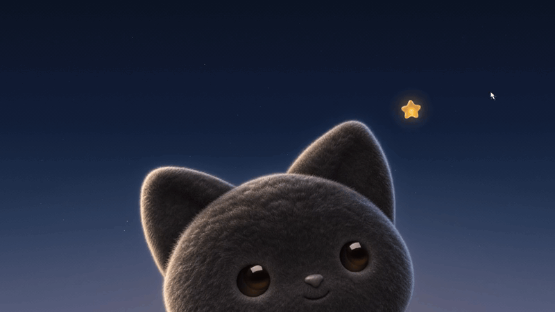
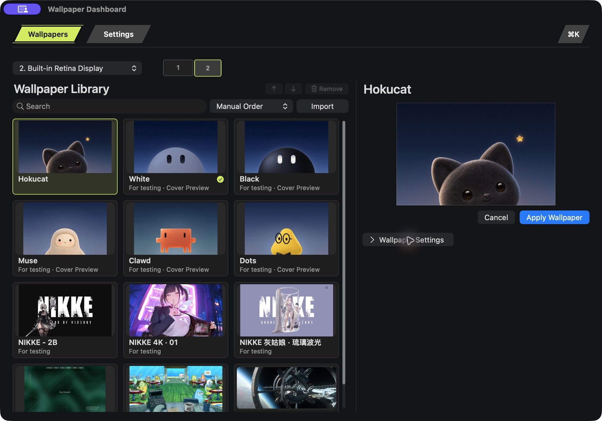

  

<h1 align="center">Hokucat</h1>

<strong>Fonds d’écran animés pour macOS</strong>

  <a href="../../README.md">English</a> · <a href="../../README.zh-CN.md">简体中文</a> · <a href="README.zh-TW.md">繁體中文</a> · <a href="README.ja.md">日本語</a> · <a href="README.ko.md">한국어</a> · <a href="README.pt-BR.md">Português (Brasil)</a> · <a href="README.es.md">Español</a> · Français · <a href="README.ar.md">العربية</a>

<strong><a href="https://github.com/ar-gen-tin/hokucat/releases/download/v1.4.74/Hokucat-1.4.74.dmg">Télécharger la préversion v1.4.74</a></strong> · <a href="https://github.com/ar-gen-tin/hokucat/releases/download/v1.4.74/SHA256SUMS.txt">SHA-256</a>

Parcourez votre bibliothèque de fonds d’écran, prévisualisez un fond et réglez ses options disponibles dans une seule fenêtre. Créez aussi vos propres fonds d’écran avec l’IA.

[Site officiel](https://hokucat.com/) · [Regarder la vidéo](../../assets/hokucat-demo.mp4) · [Créer un fond d’écran](../ai-wallpapers.md) · [Questions fréquentes](../faq.md)

*La vidéo est un montage de présentation des fonds d’écran. Les créations tierces pour PC montrées dans les supports d’aperçu sont réservées aux tests. Consultez les [auteurs et les pages d’origine](../credits.md).*

*Capture réelle du Tableau de bord des fonds d’écran dans la version 1.4.73 destinée à l’évaluation.*

## Essayer Hokucat

**La 1.4.74 est une préversion signée avec Developer ID**, compatible avec **macOS 13 ou ultérieur** sur les Mac **Apple Silicon et Intel**. La notarisation par Apple n’est pas encore terminée ; macOS peut bloquer la première ouverture. Consultez les nouveautés dans le [journal des modifications](../../CHANGELOG.md).

Téléchargez et ouvrez le DMG, faites glisser Hokucat dans le dossier Applications, puis suivez ces étapes :

1. Lancez Hokucat depuis le dossier Applications, puis choisissez **Tableau de bord des fonds d’écran…** dans la barre des menus.
2. Sélectionnez un fond d’écran. Prévisualisez-le et réglez les commandes disponibles pour cette création sur la même page.
3. Cliquez sur **Appliquer le fond d’écran**. Si vous utilisez plusieurs écrans, choisissez d’abord l’écran de destination.

## Un bureau à votre goût

- **Une bibliothèque à parcourir.** Recherchez un fond d’écran, organisez votre collection manuellement ou triez-la par nom.
- **L’aperçu et les réglages réunis.** Retrouvez la création sélectionnée à côté de ses commandes. Pour les vidéos compatibles, réglez l’adaptation à l’écran, la vitesse et le retournement horizontal avant l’application.
- **Une gestion simple de la bibliothèque.** Faites glisser les éléments pour les réordonner, utilisez le menu contextuel pour les actions courantes et supprimez les fonds importés après confirmation. Les fichiers d’origine restent à leur emplacement.
- **Des interactions familières sur Mac.** Accédez à Hokucat dans la barre des menus, conservez vos habitudes sur le bureau et jouez avec le regard du chat et son étoile à faire glisser. Les interactions disponibles varient selon le fond d’écran.
- **Un choix pour chaque écran.** Utilisez un fond différent sur chaque écran connecté. Hokucat mémorise vos choix.

L’interface de l’application est disponible en **anglais, chinois simplifié, chinois traditionnel, japonais, coréen, portugais du Brésil, espagnol, français et arabe**. Choisissez une langue dans les réglages.

## Créer un fond d’écran avec l’IA

Utilisez Codex, Claude Code ou Grok Bot pour créer une boucle vidéo originale sans son, ou choisissez une vidéo que vous avez le droit d’utiliser. Le [guide de création](../ai-wallpapers.md) propose un prompt et un exemple exécutable pour produire un paquet prêt à être chargé depuis **Tableau de bord des fonds d’écran → Importer…**.

Package v1 prend en charge les **images PNG/JPEG et les vidéos MP4/MOV/M4V sans son**. L’IA aide à créer les médias ; Hokucat lit les fichiers importés localement. Les projets interactifs génériques Web ou Windows Scene, les entrées de pointeur ou audio en temps réel et les connexions en temps réel à des API ou à des agents ne font pas partie de ce format de paquet. Certains fonds intégrés ou adaptés peuvent disposer de leurs propres fonctions interactives.

L’animation générée par le code de [`examples/make-wallpaper.py`](../../examples/make-wallpaper.py) est un exemple autonome créé pour ce dépôt. Elle est distincte des fonds d’écran tiers pour PC présentés à des fins de test.

## Questions, retours et crédits

Consultez les [questions fréquentes](../faq.md) pour les détails de compatibilité et d’importation, ou [signalez un problème](https://github.com/ar-gen-tin/hokucat/issues) en précisant vos versions de macOS et de Hokucat ainsi que les étapes pour le reproduire. Les améliorations de la documentation, des traductions et des exemples sont les bienvenues. Consultez le [guide de contribution](../../CONTRIBUTING.md).

Ce dépôt contient la documentation publique, les supports de présentation et l’exemple de création. Il **ne contient pas le code source complet de l’application Mac**. Les changements documentés de la préversion figurent dans l’[historique des modifications](../../CHANGELOG.md).

Hokucat est issu de [Grok Bot Wallpaper](https://github.com/Bodila51/grokbot-wallpaper), créé par **0xCodila (Bodila51)**. Les œuvres tierces restent attribuées à leurs créateurs ; leur présentation dans une version de test ne donne pas le droit de les redistribuer. [Origine du projet et crédits des ressources](../credits.md)
